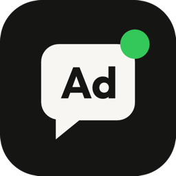

<h1 align="center">TalkToAds for AI agents</h1>

<b>Run your Meta (Facebook + Instagram) ads by talking to your agent.</b> Everything it creates starts paused until you say go.

You ask your agent *"how did my ads do last week, and what should I kill?"*. It pulls spend, results, cost per result and ROAS per campaign and tells you which to scale and which to cut. You say *"boost my latest reel to my site at ₹500 a day"*. It builds the campaign, ad set and ad, all paused, shows you the draft, and only goes live when you say yes.

- **Reports**: spend, results, CPA, ROAS, CTR, CPM by campaign, ad set or ad, with age/gender/placement breakdowns
- **Audits**: a 0–100 health score with wasted spend, ad fatigue, learning-limited ad sets and rejected ads
- **Build**: boost an Instagram reel or post in one step, or create campaigns, ad sets and ads from scratch
- **Control**: pause, change budgets, rename, with a change log and an optional daily spend cap
- **Memory**: remembers your target CPA, brand voice and words to avoid across chats
- **Free plan**: 15 tasks a month ([talktoads.com](https://talktoads.com/?ref=github))

## Install

Every option uses the same skill ([`skills/talktoads/SKILL.md`](skills/talktoads/SKILL.md)) and the same hosted MCP server, `https://talktoads.com/mcp` (sign in with Facebook, no API key).

| Agent | Install |
|---|---|
| **Any agent (skills.sh)** | `npx skills add IndianAppGuy/talktoads-agent` |
| **Claude Code** (plugin: skill + MCP) | `/plugin marketplace add IndianAppGuy/talktoads-agent` then `/plugin install talktoads@talktoads` |
| Claude Code (MCP only) | `claude mcp add --transport http talktoads https://talktoads.com/mcp` then `/mcp` to sign in |
| **Claude.ai / Claude Desktop** | Settings → Connectors → Add custom connector → `https://talktoads.com/mcp` |
| **Codex** | `npx skills add IndianAppGuy/talktoads-agent -a codex` and `codex mcp add talktoads --url https://talktoads.com/mcp && codex mcp login talktoads` |
| **Gemini CLI** | `gemini extensions install https://github.com/IndianAppGuy/talktoads-agent` |
| **Cursor** | [Add to Cursor](https://cursor.com/en/install-mcp?name=talktoads&config=eyJ1cmwiOiJodHRwczovL3RhbGt0b2Fkcy5jb20vbWNwIn0%3D) + `npx skills add IndianAppGuy/talktoads-agent -a cursor` |
| **OpenClaw** | `openclaw skills install @theindianappguy/talktoads` |
| **Hermes Agent** | `hermes skills install skills-sh/IndianAppGuy/talktoads-agent/talktoads` |
| **Any MCP client** | Streamable HTTP server `https://talktoads.com/mcp` (OAuth 2.1 + dynamic client registration) |

## Tools

| Tool | What it does |
|---|---|
| `list_ad_accounts`, `list_pages`, `list_instagram_posts`, `list_pixels` | What you can run ads from |
| `list_campaigns`, `list_ad_sets`, `list_ads` | What is running, with status, budgets and review feedback |
| `get_performance` | Spend, results, cost per result, CTR, CPM, ROAS, breakdowns, day by day |
| `audit_account` | Health score and a prioritised fix list |
| `search_interests`, `estimate_audience`, `list_custom_audiences`, `create_lookalike_audience` | Targeting |
| `boost_instagram_post` | Reel or post → campaign + ad set + ad, paused |
| `create_campaign`, `create_ad_set`, `create_ad` | Build from scratch, paused |
| `go_live`, `pause`, `update_budget`, `rename` | Control (go_live only after you approve) |
| `remember_brand_fact`, `recall_brand_memory`, `forget_brand_fact` | Brand memory |
| `get_change_log`, `get_usage`, `set_spend_cap` | Audit trail, plan, safety cap |

## Try these prompts

1. *"How did my Meta ads do in the last 7 days? Which campaign should I scale and which should I kill?"*
2. *"Audit my ad account for the last 30 days and give me the top 3 fixes."*
3. *"Boost my latest Instagram reel to example.com at ₹500 a day, India, 25–45."*
4. *"Pause every ad set with cost per purchase above ₹800."*
5. *"Remember: target CPA is ₹300 and never say 'guaranteed' in ad copy."*

## Safety

- Everything the agent creates starts **paused**. It goes live only after you say so in that chat.
- An optional daily spend cap blocks any budget above it.
- Every change is logged (`get_change_log`).
- Sign-in is Facebook OAuth. TalkToAds never sees your password. [Privacy](https://talktoads.com/privacy) · [Terms](https://talktoads.com/terms)

## License

MIT. Made by [IndianAppGuy](https://talktoads.com/?ref=github).
